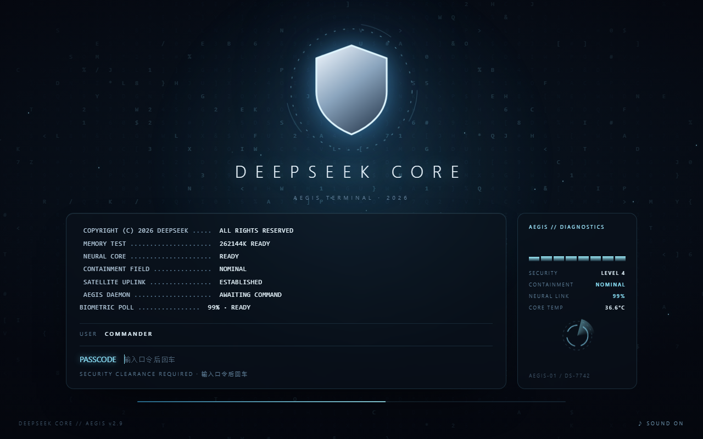
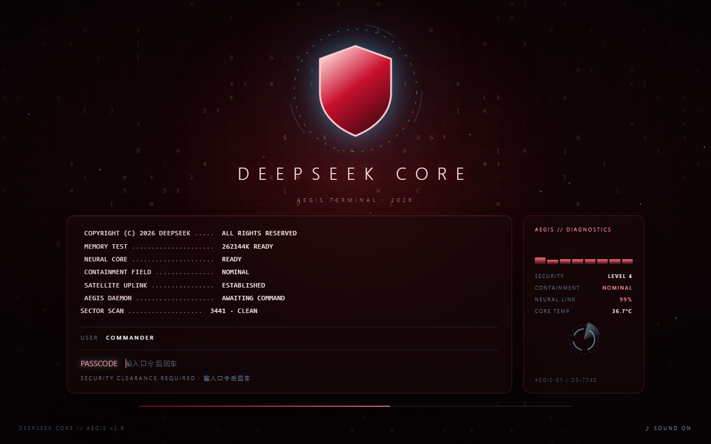
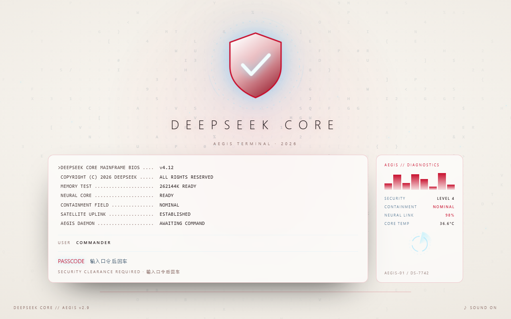
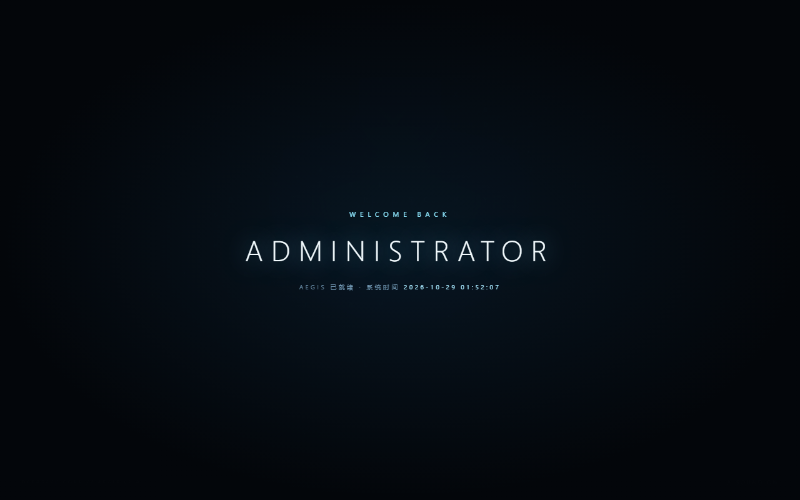

# aegis-boot

DeepSeek Harness 的**独立开机动画插件**：AEGIS 安全终端登录序列。

不依赖任何主题包，也不修改 DSH 的界面配色与品牌——只负责开屏这一段。



## 效果

- 蓝色全息背景 + 盾牌徽记 + 字符矩阵
- 左侧**滚动控制台**：持续刷新的系统日志（UPLINK / BIOMETRIC / MEMORY…）
- 右侧**诊断表**：频谱条、安全等级、神经链路、核心温度（数值会跳）
- `USER: COMMANDER` → `PASSCODE` → `VERIFYING` → `ACCESS GRANTED`
- 输错第一次：面板红框 + 轻嗡；连错两次起：全屏红光 + 双音警笛
- 通过后：白闪 → 欢迎页 `WELCOME BACK / ADMINISTRATOR` → CRT 关机收束进主界面
- 语音播报（系统 TTS）：`Mainframe online.` → `Security system engaged.` → `Awaiting credentials.` → `Welcome back, administrator.` → `Access granted. All systems nominal.`

## 三套配色

| 红黑（安布雷拉） | 白红 |
|---|---|
|  |  |

欢迎页：



## 安装

从 GitHub 安装：

```bash
dsh plugin --profile desktop add github:<用户名>/aegis-boot
```

或从本地目录安装：

```bash
dsh plugin --profile desktop add file:D:/path/to/aegis-boot
```

装完**完全退出再打开** DeepSeek Harness 生效。

## 配置

设置 → **AEGIS 开屏**：

| 项 | 说明 | 默认 |
|---|---|---|
| 主标题 | 开屏主标题 | `DEEPSEEK CORE` |
| 副标题 | 开屏副标题 | `AEGIS TERMINAL · 2026` |
| 欢迎称呼 | 欢迎页称呼 | `ADMINISTRATOR` |
| 登录口令 | 进入所需的指令 | `show me the money` |
| 配色 | 全息蓝 / 红黑 / 白红 | 全息蓝 |
| 语音播报 | 开 / 关 | 开 |

也可以直接改 profile 的 `cordis.patch.yml`：

```yaml
- id: aegis-boot
  name: aegis-boot
  config:
    name: DEEPSEEK CORE
    subtitle: AEGIS TERMINAL · 2026
    welcome: ADMINISTRATOR
    passcode: show me the money
    theme: holo
    voice: true
```

## 兼容性

- 仅在 `desktop` profile 上测试（DSH 0.2.x）
- 客户端设置面板依赖 `settings.section` slot
- 使用了浏览器的 `speechSynthesis`，语音音色取决于系统已安装的语音库

## 卸载

```bash
dsh plugin --profile desktop remove aegis-boot
```

## License

MIT
